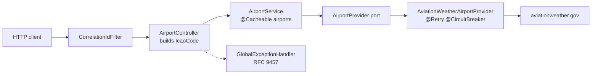

# Aviation API Wrapper

A small Spring Boot microservice that returns airport details for an ICAO code, backed by the
public [aviationweather.gov](https://aviationweather.gov/data/api/) data API.

The brief asked for a production-minded design rather than a feature list, so most of this
README is about the decisions: how the provider is isolated, how upstream failures are handled,
what each HTTP status means, and what was deliberately left out.

- [Quick start](#quick-start)
- [API](#api)
- [Running the tests](#running-the-tests)
- [Architecture](#architecture)
- [Resilience policy](#resilience-policy)
- [Error contract](#error-contract)
- [Observability](#observability)
- [Assumptions](#assumptions)
- [Working with AI agents](#working-with-ai-agents)
- [AI-generated code](#ai-generated-code)

## Quick start

Requirements: **JDK 25** (the Gradle wrapper is included) or **Docker**.

```bash
# Gradle
./gradlew bootRun
# or build the jar
./gradlew bootJar && java -jar build/libs/aviation-api-wrapper-1.0.0.jar

# Docker
docker build -t aviation-api-wrapper .
docker run --rm -p 8080:8080 aviation-api-wrapper
```

Then:

```bash
curl -s http://localhost:8080/api/v1/airports/KJFK | jq
curl -i http://localhost:8080/api/v1/airports/ZZZZ      # 404 problem+json
curl -i http://localhost:8080/api/v1/airports/K1A       # 400 problem+json
```

Swagger UI: <http://localhost:8080/swagger-ui.html> - OpenAPI JSON: `/v3/api-docs`.

Stack: Java 25, Spring Boot 4.1.1, Gradle 9.8 (Kotlin DSL), Resilience4j 2.4, Caffeine,
Micrometer/Prometheus, springdoc-openapi 3.1, WireMock 3.13 (tests).

## API

### `GET /api/v1/airports/{icao}`

`icao` is a four-letter ICAO location indicator, case-insensitive (`kjfk` == `KJFK`).

```json
{
  "icao": "KJFK",
  "iata": "JFK",
  "name": "NEW YORK/JOHN F KENNEDY INTL",
  "state": "NY",
  "country": "US",
  "latitude": 40.6399,
  "longitude": -73.7787,
  "elevationMeters": 4,
  "runways": [
    { "id": "04L/22R", "dimension": "12079x200", "surface": "C" },
    { "id": "13R/31L", "dimension": "14511x200", "surface": "C" }
  ],
  "source": "aviationweather"
}
```

`iata`, `state`, `elevationMeters` are omitted when the provider does not have them. `source`
identifies which provider served the record, which matters once more than one is wired in.
Every response carries an `X-Correlation-Id` header (echoed from the request when present,
generated otherwise).

## Running the tests

```bash
./gradlew test            # unit + integration
./gradlew build           # compile, test, package
open build/reports/tests/test/index.html
```

| Level | Class | What it proves |
|---|---|---|
| Unit | `IcaoCodeTest` | normalisation and rejection rules |
| Unit | `AviationWeatherAirportMapperTest` | mapping, identifier must match the requested ICAO, blank name and impossible coordinates rejected |
| Unit | `AirportServiceTest` | delegation to the provider port |
| Integration | `AirportLookupIntegrationTest` | full HTTP stack with WireMock standing in for aviationweather.gov: happy path, every error path, retry/breaker behaviour (open, short-circuit, recovery), cache sharing and stampede protection, framework errors (404/405/406) |
| Integration | `OperationalEndpointsIntegrationTest` | health probes and breaker state, Prometheus metric families, OpenAPI document |

Both integration classes extend `IntegrationTestSupport`, which boots the real application
context once on a random port, points the provider at a WireMock server and resets WireMock,
the circuit breaker and the cache before every scenario. Call counts are asserted on WireMock
so the retry policy is verified, not assumed.

[`docs/scenarios.md`](docs/scenarios.md) maps every expected scenario, grouped by the assignment's
evaluation criteria (correctness, resilience, scalability, extensibility, observability), to the
test that proves it.

The `test` profile (`src/test/resources/application-test.yml`) keeps the same policy shape with
millisecond timings so the whole suite runs in a few seconds.

### Formatting

Code style is enforced with [Spotless](https://github.com/diffplug/spotless):
[palantir-java-format](https://github.com/palantir/palantir-java-format) for Java, ktlint for the
Gradle Kotlin scripts, and whitespace rules for YAML/Markdown/Dockerfile. `spotlessCheck` is part
of `check`, so an unformatted change fails `./gradlew build` locally and in CI.

```bash
./gradlew spotlessCheck   # report violations
./gradlew spotlessApply   # fix them
```

## Architecture



```
com.msvieira.aviation
├── domain                     Airport, Runway, IcaoCode, AirportProvider (port), exceptions
├── application                AirportService (caching, delegation)
├── adapter
│   ├── web                    AirportApi (OpenAPI contract), AirportController, AirportResponse,
│   │                          ProblemDocumentation, GlobalExceptionHandler, CorrelationIdFilter
│   └── aviationweather        AviationWeatherAirportProvider, AviationWeatherStatusHandler, DTO, mapper, properties
└── config                     RestClientConfig, CacheConfig, OpenApiConfig, ResilienceEventLogging
```

Decisions worth calling out:

- **One port, one adapter.** `AirportProvider` is the only thing the application knows about
  data sources. `AviationWeatherAirportProvider` adapts the HTTP API to it and is responsible for
  turning every transport outcome into a domain exception. Adding a second provider means a
  second adapter and a wiring decision; nothing above the port changes.
- **The adapter is split by concern, not by layer.** `AviationWeatherStatusHandler` is a
  `ResponseErrorHandler` registered on the vendor's `RestClient`: every 4xx/5xx becomes a domain
  exception before the provider sees it (429 with `Retry-After` in seconds, 5xx, unexpected 4xx
  logged with a truncated body). The provider itself only builds the request and handles "no
  data", "undecodable body" and I/O failures. A second provider would get its own handler; the
  shared pieces are extracted when a second one exists and shows what is actually shared.
- **No ceremony above that.** There is no use-case interface with a single implementation, no
  separate "client" class behind the adapter, and no hand-written decorators. For one operation
  those classes would only forward calls. Resilience and caching are applied declaratively
  (`@Retry`, `@CircuitBreaker`, `@Cacheable`) where they belong.
- **Validation happens at the edge.** `IcaoCode` is a value object that normalises
  (`toUpperCase(Locale.ROOT)`) and validates (`^[A-Z]{4}$`) in its constructor. The controller
  builds it, so an invalid code never reaches the service, the cache or the provider.
- **Stateless.** The only state is the local Caffeine cache, which is an optimisation, not a
  dependency. Any instance can serve any request; horizontal scaling needs no coordination.
- **Exceptions carry meaning, not transport.** The resilience policy and the HTTP error mapping
  are expressed in terms of `UpstreamTimeout`, `UpstreamUnavailable`, `UpstreamRateLimited`,
  `UpstreamBadResponse` and `AirportNotFound`, never in terms of `ResourceAccessException` or
  status codes. That keeps `application.yml` readable and makes the policy testable.
- **Documentation lives next to the contract, not the behaviour.** `AirportApi` is an interface
  that carries the OpenAPI annotations (operation, parameters, operation-specific responses);
  `AirportController` implements it and only keeps the MVC routing and the one-line body.
  Error responses shared by every operation (400/500/502/503/504 with the `Problem` schema and
  the `Retry-After` header) are registered once by `ProblemDocumentation`, a springdoc
  `OperationCustomizer`, so a new endpoint is documented consistently without repeating them.

## Resilience policy

All numbers live in `application.yml`.

| Layer | Setting | Value |
|---|---|---|
| HTTP client | connect timeout / read timeout (per attempt) | 1 s / 2 s |
| HTTP client | `User-Agent` | `aviation-api-wrapper/1.0 (+repo url)` as the provider requests |
| Retry | attempts | 3 (initial + 2 retries) |
| Retry | backoff | exponential, 200 ms then 400 ms |
| Retry | retried | `UpstreamTimeout`, `UpstreamUnavailable` (5xx, I/O) |
| Retry | not retried | `AirportNotFound`, `UpstreamRateLimited` (429), `UpstreamBadResponse`, `CallNotPermitted` (circuit open), `BulkheadFull`, `RequestNotPermitted` (local budget) |
| Circuit breaker | window / minimum calls | 10 calls / 5 |
| Circuit breaker | opens at | 50 % failures |
| Circuit breaker | open for / half-open probes | 30 s / 3 |
| Circuit breaker | counted as failure | the four `Upstream*` exceptions |
| Circuit breaker | ignored | `AirportNotFound`, `BulkheadFull`, `RequestNotPermitted` |
| Bulkhead | max concurrent provider calls / max wait for a permit | 32 / 500 ms, then 503 `upstream-saturated` |
| Rate limiter | calls per instance / refresh / wait | 10 / 8 s / none, then 503 `outbound-rate-limited` + `Retry-After: 8` |
| Cache | Caffeine, `expireAfterWrite` / `maximumSize` | 10 min / 10 000 entries, successes only |
| Threads | `spring.threads.virtual.enabled` | `true` (Java 25, no pinning on `synchronized`) |

**Composition.** Resilience4j's default aspect order is
`Retry( CircuitBreaker( RateLimiter( Bulkhead( method ) ) ) )`. Consequently the breaker records
**every attempt**, not the final outcome of a request, so it reacts faster to a degraded
provider, and each attempt spends one local rate-limit permit. When the breaker is open,
`CallNotPermittedException` is raised before the adapter runs; the retry policy ignores it, so
an open circuit is answered immediately with 503 and no further load is generated. A full
bulkhead (`BulkheadFullException`) and an exhausted local budget (`RequestNotPermitted`)
are likewise neither retried nor counted by the breaker: they say something about this instance,
not about the provider's health.

**Outbound budget.** The provider documents 100 requests per minute. A Resilience4j cycle of
100 permits per minute would not enforce that: the bucket refills in full at the boundary, so
100 calls at 59.9 s and another 100 at 60.1 s all reach the upstream. The configured cycle is
**10 permits every 8 seconds**, with no wait. A rejection is 503 `outbound-rate-limited` and
carries `Retry-After: 8`, the length of the cycle (a safe upper bound until the next refill).
The boundary burst is 20 calls, and any 60-second span stays at or below 90, under the
provider's limit. A sliding window would use the quota more evenly; this exercise keeps the
built-in fixed cycle and spends the quota conservatively. The counter is still **per instance**:
two replicas can each send that budget. A shared limit needs a gateway or a distributed limiter.
The bulkhead remains a concurrency cap (32 in flight), which is a different limit.

**Concurrency model.** Requests run on virtual threads (`spring.threads.virtual.enabled=true`),
so a slow provider parks cheap virtual threads instead of exhausting a platform thread pool;
throughput under upstream latency is bounded by memory and the provider, not by
`server.tomcat.threads.max`. That removes the implicit cap on in-flight provider calls, which is
why the bulkhead exists: at most 32 requests talk to aviationweather.gov at once (a permit is
awaited for up to 500 ms), the rest fail fast with 503 `upstream-saturated` rather than piling
up sockets against a provider that is already struggling. A reactive stack (WebFlux + WebClient)
would buy nothing here that virtual threads do not already provide, at the cost of a different
programming model and the Reactor variants of the resilience operators.

**Latency.** Timeouts are per attempt and there is no global per-request deadline. In the
simplified model of three attempts that all time out, the upper bound is
`3 x (1 s + 2 s) + 200 ms + 400 ms ~= 9.6 s`. The actual figure depends on the HTTP client,
the kind of failure and the phase in which it happens (a refused connection fails in
milliseconds; a stalled read takes the full 2 s).

**429 handling.** A `429` from the provider is **not retried**: retrying would add load to a
service that just asked us to back off, and a `Retry-After` of 60 s would make a 200 ms retry
pointless anyway. The exception is recorded by the breaker (repeated throttling opens it) and
the `Retry-After` value, when present as a number of seconds, is forwarded to our caller. The
HTTP-date form allowed by RFC 9110 is not parsed: this provider sends seconds.

**Cache.** Airport master data changes rarely; a 10-minute TTL removes repeated lookups of the
same code and `sync = true` collapses concurrent misses for that code into one provider call.
Only successful lookups are stored (`@Cacheable` never caches exceptions), and the key is the
normalised code. A miss while the provider is down is 503/504. Serving the last successful
record past its TTL (stale cache) would fit airport data, but only with the age of the record
in the response and an explicit maximum age; that is not implemented. A second provider is out
of scope: coverage and field contracts differ, and a fallback that silently switches source
would hide which record the caller received. `upstream-error` is a generic mapping for an
unmapped `UpstreamException`, not a fallback.

## Error contract

Errors are RFC 9457 Problem Details (`application/problem+json`) with a stable `type` URN, a
`timestamp` and the request's `correlationId`.

| HTTP | `type` suffix | When | Retry? |
|---|---|---|---|
| 400 | `invalid-icao-code` | code is not four letters | no |
| 404 | `airport-not-found` | provider answered 204 / empty list | no |
| 502 | `upstream-bad-response` | unexpected 4xx, undecodable body, null record, identifier that does not match the requested ICAO, blank name, or coordinates that are missing/non-finite/out of range | no, something is wrong on our side or the contract changed |
| 503 | `upstream-unavailable` | provider answered 5xx or an I/O failure persisted after retries | yes, later |
| 503 | `upstream-rate-limited` | provider answered 429; `Retry-After` forwarded when known | after `Retry-After` |
| 503 | `upstream-circuit-open` | breaker open; upstream not called | yes, within ~30 s |
| 503 | `upstream-saturated` | 32 provider calls already in flight and no permit freed within 500 ms; upstream not called | yes, immediately |
| 503 | `outbound-rate-limited` | this instance has spent its 10 calls for the current 8 s cycle; `Retry-After: 8`; upstream not called | after `Retry-After` |
| 504 | `upstream-timeout` | provider did not answer within the read timeout on any attempt | yes, later |
| 502 | `upstream-error` | safety net for an `UpstreamException` subtype without an explicit mapping | - |
| 404 / 405 / 406 / ... | `resource-not-found`, `method-not-allowed`, `not-acceptable`, ... | framework-level errors (unknown route, wrong method, `Accept` we cannot satisfy); slug derived from the status | no |
| 500 | `internal-error` | anything unexpected; details only in logs | - |

```json
{
  "type": "urn:aviation-api-wrapper:problem:airport-not-found",
  "title": "Airport not found",
  "status": 404,
  "detail": "No airport record available for ICAO code 'ZZZZ'",
  "instance": "/api/v1/airports/ZZZZ",
  "timestamp": "2026-10-15T15:05:06.579795Z",
  "correlationId": "b0706f23-64b5-4503-8bcc-ddf4f191e177"
}
```

Two implementation notes: `CallNotPermittedException` is mapped explicitly in the handler
because the Resilience4j aspect throws it before the adapter (and its exception translation)
runs; and the handler extends `ResponseEntityExceptionHandler`, so Spring MVC's own
exceptions (unknown route, unsupported method, content negotiation, malformed input) share
the same Problem Details shape instead of falling through to a generic 500. Boot backs off
its built-in problem-details advice when such a bean exists, which also avoids the
cause-chain matching that would otherwise intercept a decoding failure
(`HttpMessageNotReadableException` nested inside `UpstreamBadResponseException`).

## Observability

| Endpoint | Purpose |
|---|---|
| `/actuator/health` | aggregate status with the circuit breaker's state, metrics and failure rate as a component |
| `/actuator/health/liveness` | used by the Docker `HEALTHCHECK` |
| `/actuator/health/readiness` | for an orchestrator's readiness probe |
| `/actuator/metrics`, `/actuator/prometheus` | `resilience4j_circuitbreaker_*`, `resilience4j_retry_*`, `cache_*` (hits/misses/size), `http_server_requests_*`, `http_client_requests_*`, JVM |
| `/actuator/info` | application name and description |

The circuit breaker is registered as a health indicator with `allow-health-indicator-to-fail:
false`: an open circuit does **not** turn the aggregate `DOWN`. An upstream outage is not a
reason to restart this instance, which is also why the container healthcheck targets the
liveness group only. Component details (`diskSpace`, local paths, breaker metrics) are hidden
by default (`management.endpoint.health.show-details: never`). For a local demo, set it to
`always`. Only `health`, `info`, `metrics` and `prometheus` are exposed. In production those
must be reachable only through the network, a gateway or authentication. Moving them to another
port, by itself, does not protect them. This exercise leaves them open because authentication
is out of scope.

Logs are plain text with the correlation id on every line (`[cid=...]`), plus explicit lines
for each retry attempt and each breaker state transition. `logback-spring.xml` pins the
console appender to Boot's text encoder so that pattern can carry `[cid=...]`;
`logging.structured.format.console=ecs` therefore has **no** effect while that file is in
place. JSON would mean dropping the custom console appender, not flipping a property.

## Assumptions

- **Only the ICAO lookup is in scope.** No authentication, no user management, no other
  endpoints.
- **204 means "no record at this provider".** aviationweather.gov answers 204 with no body for
  unknown codes. We map it to 404, but that only states the configured provider cannot serve
  the code; it does not prove the airport does not exist.
- **ICAO codes are four letters.** FAA location identifiers with digits (e.g. `K1G3`) are not
  ICAO indicators and are rejected with 400.
- **`elev` is in metres.** Verified against the real payload (KJFK `elev: 4` = 13 ft; SBGR
  `elev: 745` ~= 2 459 ft), hence `elevationMeters`.
- **Provider data is not corrected, but it is rejected when unusable.** The provider reports
  `state: "PR"` for SBGR (Guarulhos is in SP); that is passed through, and `source` tells the
  caller where the record came from. `name` is trimmed. A blank name, a missing identifier, an
  identifier that is not the requested ICAO, or coordinates outside [-90, 90] / [-180, 180]
  (including NaN/Infinity) become 502 `upstream-bad-response` and are not cached.
- **Runway `dimension` is a provider string** (`12079x200`), units are the provider's (feet for
  FAA records). It is not parsed into numbers because the format is not documented.
- **Airport data is nearly static**, which justifies a short TTL cache without invalidation.
- **The provider may be unstable** (as the brief states), and it is. Measured directly during
  development, the same unknown-code lookup answered in 0.25 s, 0.8 s and 14.7 s on consecutive
  calls. That tail is why the read timeout is a deliberately short 2 s with retries, rather
  than a long timeout that would pin a request thread for 15 s: through the wrapper the slow
  case cost two timed-out attempts and succeeded on the third (~6.4 s end to end).
- **Synchronous client on purpose.** `RestClient` was chosen over `WebClient` and OpenFeign.
  `WebClient` only pays off on a reactive stack; calling `.block()` from MVC adds reactor-netty
  and the Reactor flavour of Resilience4j for no gain. Spring Cloud OpenFeign is in maintenance
  mode and the modern declarative option, `@HttpExchange`, sits on top of `RestClient` anyway;
  for one endpoint the explicit client is clearer, and the migration is incremental if more
  provider operations appear. Scalability under latency comes from virtual threads, not from an
  asynchronous API.


## Working with AI agents

`.cursor/skills/` contains versioned [Cursor Agent Skills](https://cursor.com/docs/context/skills)
that encode this project's architecture and conventions so that AI-assisted changes and reviews
stay consistent with it:

| Skill | Purpose |
|---|---|
| `project-context` | Layering rules, error contract, resilience policy, conventions; loaded by the others |
| `create-endpoint` | Checklist and templates for a new HTTP operation |
| `create-external-integration` | Port/adapter, exception translation table, Resilience4j wiring, required tests |
| `write-tests` | Unit vs integration decision, WireMock pattern, state reset, call-count assertions |
| `code-review` | Severity-ranked review against the rules above (`/code-review` on a diff or PR) |

## AI-generated code

AI (Cursor, agent mode)

- **This README** was drafted by the AI from the implementation and the decisions taken during
  planning, then reviewed and edited by hand. Every number in it (timeouts, latency budget,
  measured provider latencies, call counts) comes from the code or from real calls made during
  development, not from the model's recollection.
- **Unit tests** (`IcaoCodeTest`, `AviationWeatherAirportMapperTest`, `AirportServiceTest`) were
  generated by the AI against the behaviour specified in the plan and in
  [`docs/scenarios.md`](docs/scenarios.md); the
  integration scenarios were written the same way and verified by running them, including
  repeated runs of the concurrency-sensitive ones to rule out flakiness.
- **A `/code-review` skill** (`.cursor/skills/code-review`) was created so that AI reviews of
  this repository are performed against its own architecture rules, resilience policy, error
  contract and conventions instead of generic preferences. It loads `project-context`, runs
  `./gradlew spotlessCheck test` and reports severity-ranked findings with `file:line` and a
  proposed fix. The remaining skills in the table above were produced in the same session.
